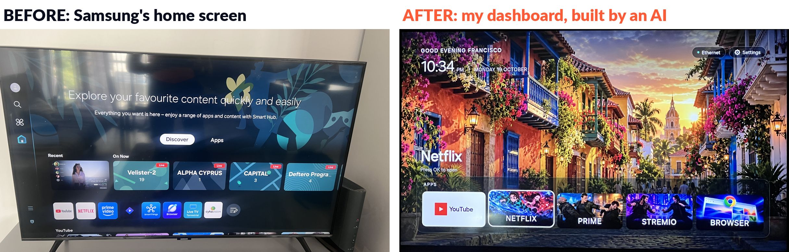
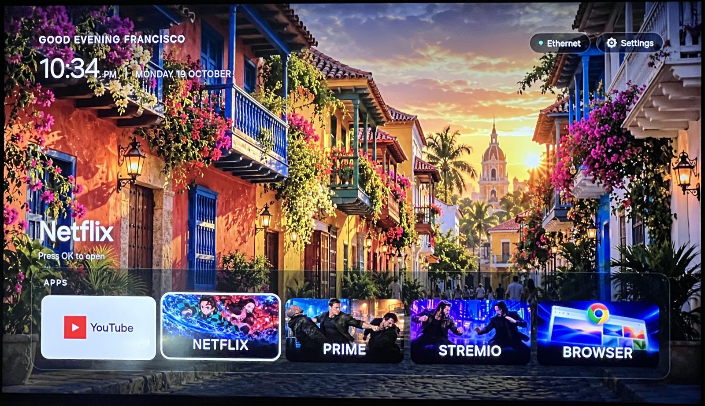
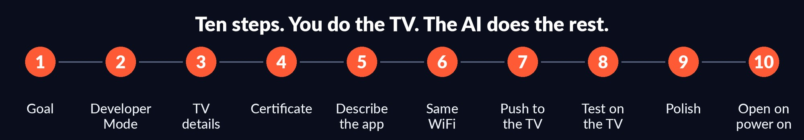
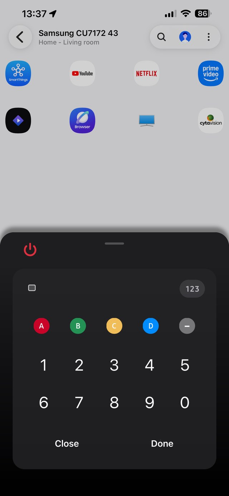
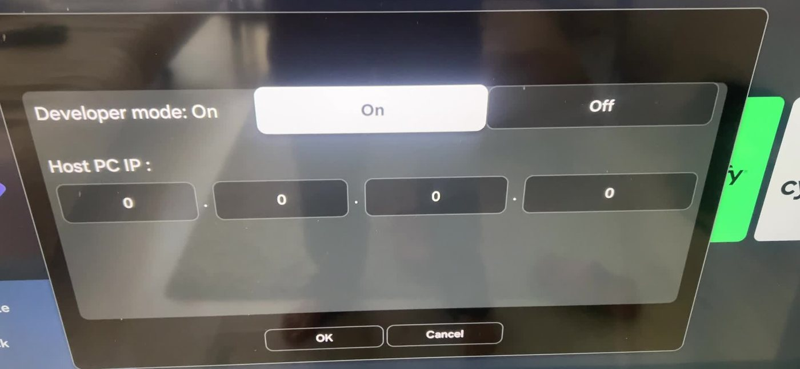
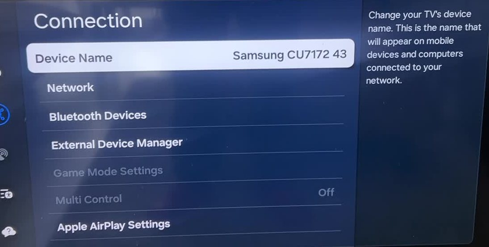
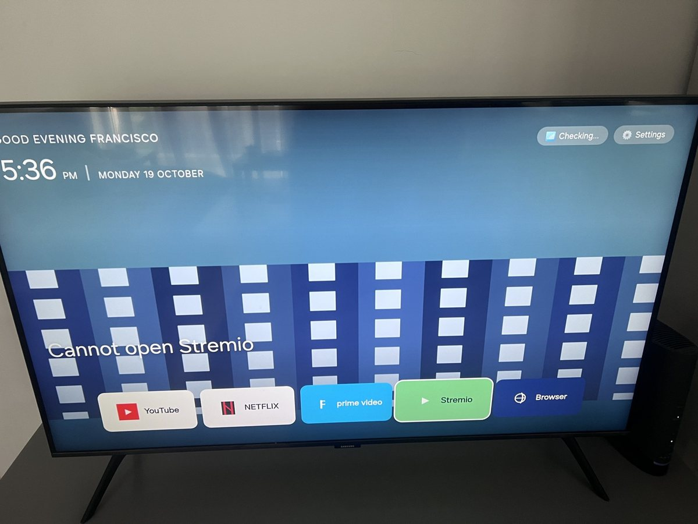
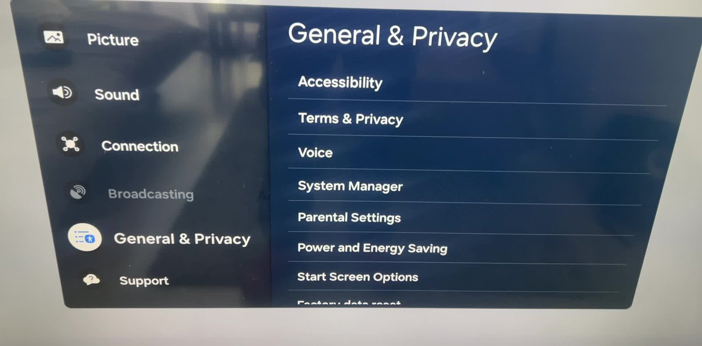
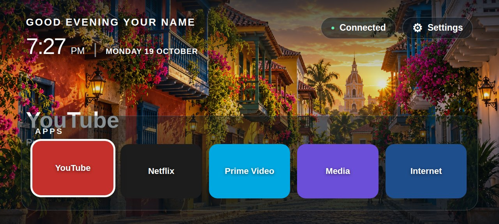

# tvibe

**Vibe code your TV.** Tell an AI your TV's model number. It walks you through it, builds a custom home dashboard, and installs it on your TV. You write no code. You do the TV button presses and the Samsung sign-in; the AI does the rest.

Born from one afternoon on a real Samsung TV. Samsung first. Android TV and LG next.

> Made by **Francisco Cordoba Otalora** ([@fcordobaot](https://x.com/fcordobaot)).

## What you get

- A clean, full-screen dashboard for your TV: clock, greeting, wallpaper, and big cards for the apps you use.
- A **step-by-step skill** any LLM coding agent can follow: ten steps, each with the exact prompt to give it.
- The traps we hit and how we got past them: the Developer Mode keypad, the Samsung certificate, "transferred" installs that install nothing, wrong app IDs.

## How it works

You do the physical steps on the TV. The LLM does everything else. At every step you show it what you see, with a photo.

| # | Step | Prompt |
|---|---|---|
| 1 | Tell it the goal | [prompts/01-goal.md](prompts/01-goal.md) |
| 2 | Developer Mode | [prompts/02-developer-mode.md](prompts/02-developer-mode.md) |
| 3 | Read the TV details | [prompts/03-read-the-tv.md](prompts/03-read-the-tv.md) |
| 4 | The certificate | [prompts/04-certificate.md](prompts/04-certificate.md) |
| 5 | Describe the app | [prompts/05-describe-the-app.md](prompts/05-describe-the-app.md) |
| 6 | Same WiFi as the TV | [prompts/06-same-wifi.md](prompts/06-same-wifi.md) |
| 7 | Push it to the TV | [prompts/07-push-to-the-tv.md](prompts/07-push-to-the-tv.md) |
| 8 | Test on the real TV | [prompts/08-test-on-the-real-tv.md](prompts/08-test-on-the-real-tv.md) |
| 9 | Polish by asking | [prompts/09-polish.md](prompts/09-polish.md) |
| 10 | Open on power on | [prompts/10-open-on-power-on.md](prompts/10-open-on-power-on.md) |

## See the whole process

The result, on a real TV:

Real photos from the TV this came from, in order.

**Step 2, Developer Mode.** The 123 button on the Samsung remote does not type numbers. Use the number pad in the SmartThings phone app, then switch the panel to On and enter your computer's IP address.

**Step 6, same WiFi.** Your computer must reach the TV. The TV's network settings are under Settings, Connection, Network.

**Step 8, test on the real TV.** The first version looked right and every card said "Cannot open". The app IDs were placeholders. Photos like this one are how the AI finds and fixes problems.

**Step 10, open on power on.** Settings, General and Privacy, Start Screen Options. Turn off Start with Smart Hub Home and turn on Autorun Last App.

**The template.** What you get out of the box, before you add your own wallpaper and apps (rendered here in a desktop browser).

## Quick start

You need: a Samsung smart TV that runs Tizen, a computer on the same WiFi, a free Samsung developer account, and an LLM coding agent that can run commands and read images (for photos of your TV).

1. Clone this repo.
2. Give your agent [`SKILL.md`](SKILL.md). If it supports skills, put the folder in its skills directory. Otherwise paste the file in.
3. Say: "Use tvibe. My TV is a Samsung <model>."
4. Follow along. It will ask you for photos and button presses.

## Tested on

| TV | Result |
|---|---|
| Samsung UE43CU7172 (2023 Crystal UHD) | The full flow was proven end to end with the original dashboard this template comes from, including power-on resume |

**Honest status:** this cleaned template renders correctly in a desktop browser. It has not yet been installed on a TV as a separate package, and it has been tested on one TV model only. It requires Tizen 7.0 or newer (`required_version` in `template/app/config.xml`); lower it for older TVs at your own risk. If you install it, please open an issue or pull request with your model and result.

Tried it on another model? Open a pull request and add a row.

The manifest and CLI commands are the ones that worked on the TV above. Samsung's own samples sometimes differ (for example the `tizen:profile` name), so validate in Tizen Studio if Samsung's tools complain.

## What it can't do

- It does not replace Samsung's home screen. It opens from your Apps list.
- It cannot force itself to start at boot. Samsung does not allow that for normal apps. The TV's **Autorun Last App** setting opens it after power-on when it was the last app you used.
- App IDs differ between models and regions, so the agent reads them from your TV.
- Samsung sign-in and the certificate screens need you, in your browser. The agent guides you and runs the commands.
- Developer Mode opens a debug port. Use it on a trusted network and turn it off when you finish.

## Safety and legal

- Use it only on a TV you own. Developer Mode and certificates are Samsung's official routes.
- Keep your certificates (`.p12`), passwords and your TV's Unique Device ID private. The `.gitignore` here blocks the certificate files.
- This project is not affiliated with or endorsed by Samsung. Samsung and Tizen are trademarks of their owners. The template ships no third-party logos or artwork.
- Provided as is, without warranty. You are responsible for what you install on your TV.

## Credits

The sample wallpaper is an AI-generated image made by the author and released under the same MIT license.

## License

MIT. See [LICENSE](LICENSE).
